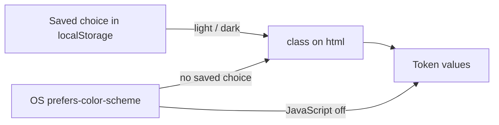
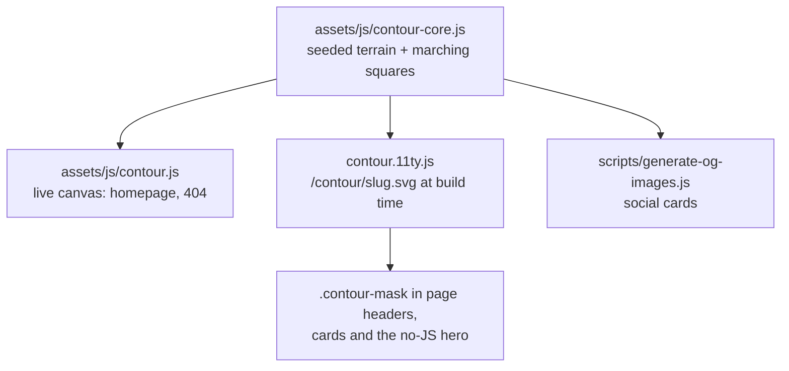

# Design System

The site's visual identity is a **topographic map**: a nod to the years spent mapping on Google Map Maker. Pages are calm and typographic; the map is the one bold element.

## Colour tokens

Colours are CSS variables (RGB channels) in `styles/main.css`, exposed to Tailwind in `tailwind.config.js`. Always use the token utilities so both themes work:

| Token     | Use                                  | Utility examples                   |
| --------- | ------------------------------------ | ---------------------------------- |
| `paper`   | Page background                      | `bg-paper`, `from-paper`           |
| `surface` | Cards, inputs, the command palette   | `bg-surface`                       |
| `ink`     | Main text, primary buttons           | `text-ink`, `bg-ink`, `border-ink` |
| `muted`   | Secondary text, labels               | `text-muted`                       |
| `line`    | Borders and rules                    | `border-line`                      |
| `accent`  | Links, highlights, the "you" contour | `text-accent`, `decoration-accent` |
| `brand`   | The green of the logo                | `text-brand`                       |
| `contour` | Contour lines (used by CSS/JS only)  | `.contour-mask`                    |

- Light is the default; dark comes from the OS, or from the visitor's choice (`html.dark` / `html.light`).
- The inline script in `base.njk` sets the class **before first paint**, so there is no flash.
- Without JavaScript the tokens still follow the OS through `@media (prefers-color-scheme: dark)`.
- Print always uses the light palette.

**Don't** use raw colours (`text-gray-600`, `#666`) or `dark:` variants for colours. Use tokens. `dark:` is fine for things that only make sense with JS, like swapping the theme icon.

## Typography

Self-hosted latin subsets in `assets/fonts/` (SIL Open Font License, from Google Fonts):

| Role    | Family              | Utility        | Notes                                                     |
| ------- | ------------------- | -------------- | --------------------------------------------------------- |
| Display | Bricolage Grotesque | `font-display` | Variable weight and width. `.wordmark-name` sets width 75 |
| Body    | Geist               | `font-sans`    | Default body face                                         |
| Labels  | Geist Mono          | `font-mono`    | Eyebrows, dates, code. `.eyebrow` for uppercase labels    |

Article and project bodies use `.prose` (in `styles/main.css`) for Markdown output.

## Contour maps

- **One engine, three outputs.** `contour-core.js` is a UMD module used by the browser, the build and the OG script, so a page header, its social card and its terrain always match. Terrain is seeded from the page slug.
- **Static maps** are SVGs used as CSS masks: `class="contour-mask"` with `style="--contour-src: url('/contour/<slug>.svg')"`. They take the theme's contour colour and need no JavaScript.
- **Live maps** use `[data-contour-live="<seed>"]` with a `<canvas>` and a `[data-contour-static]` fallback inside. The pointer raises a hill whose rings turn the accent colour; `[data-contour-pos]` and `[data-contour-elev]` show coordinates and height. It draws at most 30 frames per second, pauses off-screen and in background tabs, and stays still under `prefers-reduced-motion` (redrawing only when the pointer moves).
- The list of SVGs comes from the `contourMaps` collection in `.eleventy.js`. Articles and projects are added automatically; add other slugs there.

## Command palette

`assets/js/command.js` + the `<dialog id="cmdk">` in `base.njk`.

- Opens with `Ctrl/⌘ K`, `/`, or any `[data-cmdk-open]` element.
- Searches `/search.json` (built by `search.11ty.js`) plus pages and actions. The index loads on first open.
- Triggers are links to `/articles/`, so without JavaScript they still work.

## Motion

- Cross-document View Transitions are on (`@view-transition` in `main.css`). Article and project titles share a `view-transition-name` (`vtName` filter) between list and page so they morph.
- Everything respects `prefers-reduced-motion`.
